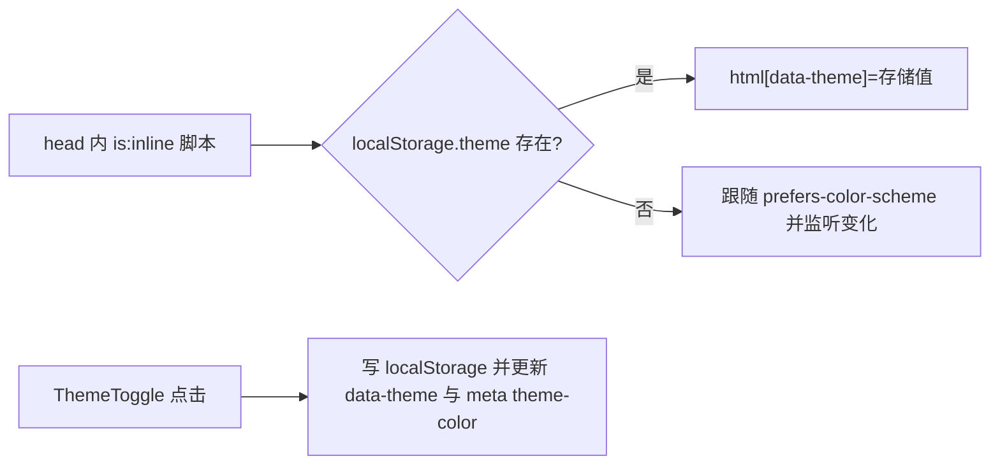

# Astro 7 + Tailwind v4 纯静态博客框架 — 实施计划

## 已确认的技术决策

- 包管理：pnpm 12.3.4（Node v26.8.1）
- 框架：`astro@^7.3.2`（内置 Vite 8 + Rolldown，Rust 编译器，Rust Markdown 管线 Sätteri）。Rsbuild 因与 Astro 的 Vite 管线不兼容而放弃
- 样式：`tailwindcss@^4.3.3` + `@tailwindcss/vite@^4.3.3`（4.2.2 起官方支持 Vite 8）+ `@tailwindcss/typography`（排版 Markdown 正文）
- 官方集成：`@astrojs/mdx@^8`、`@astrojs/sitemap@^3.7`、`@astrojs/rss@^4`、`sharp`（图片优化）、`@astrojs/check` + `typescript`（类型检查）
- 输出：`output: 'static'`，产物为 `dist/`，可直接部署到 GitHub Pages / Vercel / Netlify / Cloudflare Pages
- 不使用 remark/rehype 插件（Astro 7 默认已切到 Sätteri，加插件需额外装 `@astrojs/markdown-remark`）。目录、阅读时间均用 Astro 自带 `render()` 的 `headings` 与自写工具函数实现

## 配色：灰 + 深蓝可行，关键在三点

这个组合是低风险的经典搭配（GitHub、Stripe 文档都是 slate 灰 + 蓝的体系），效果好坏取决于：

1. 灰用"蓝灰"（Tailwind `slate` 系）而非纯中性灰，让灰和蓝同色相，不会显脏
2. 深蓝只做强调色（链接、按钮、标签、焦点环、选中态），大面积区域交给灰阶层次（页面底 / 卡片面 / 边线）
3. 深色模式下深蓝（#1e40af）在深底上对比度不足，切换成更亮的蓝（#60a5fa）；背景改用深蓝灰，整体气质不变

所有颜色集中为约 10 个语义令牌，写在 `src/styles/global.css`，改一处全站生效：

- 浅色：`canvas #f8fafc`、`surface #ffffff`、`ink #0f172a`、`muted #475569`、`line #e2e8f0`、`accent #1e40af`、`accent-hover #1e3a8a`、`accent-fg #ffffff`、`accent-soft #dbeafe`
- 深色：`canvas #0f172a`、`surface #1e293b`、`ink #e2e8f0`、`muted #94a3b8`、`line #334155`、`accent #60a5fa`、`accent-hover #93c5fd`、`accent-fg #0f172a`、`accent-soft rgb(96 165 250 / .14)`
- 正文与强调色对比度均满足 WCAG AA；实现后用 headless Edge 截取浅/深两套截图供直观评估，不满意只需改令牌

## 项目结构

```
H:\Blog                      # 框架仓库（git repo A）
├─ PLAN.md                   # 本计划
├─ astro.config.mjs          # site、mdx/sitemap 集成、tailwind vite 插件、Shiki 双主题
├─ package.json / pnpm-lock.yaml / tsconfig.json / .gitignore / README.md
├─ public/                   # favicon.svg、robots.txt
├─ content/                  # 内容仓库（独立 git repo B，被仓库 A 的 .gitignore 忽略）
│  ├─ README.md              # 文章 frontmatter 模板与写作约定
│  └─ posts/*.md             # 3 篇示例文章（功能介绍 / Markdown 与代码展示 / 配色说明），图片随文章放同级目录
└─ src/
   ├─ site.config.ts         # 站点标题、描述、作者、URL、导航、社交链接、每页篇数
   ├─ content.config.ts      # posts 集合 schema，glob base 指向 ./content/posts
   ├─ styles/global.css      # Tailwind 入口 + 配色令牌 + dark 变体 + Shiki 深色变量 + prose 微调
   ├─ lib/                   # posts.ts（排序/过滤草稿/标签聚合）、reading-time.ts（中英混排）、date.ts
   ├─ layouts/               # BaseLayout.astro（html 壳 + Header/Footer）、PostLayout.astro（文章 + 目录）
   ├─ components/            # BaseHead、Header、Footer、ThemeToggle、PostCard、Tag、TableOfContents、Pagination、FormattedDate
   └─ pages/
      ├─ index.astro         # 首页：简介 + 最新文章
      ├─ posts/[...page].astro   # 文章列表（paginate 分页）
      ├─ posts/[slug].astro      # 文章详情：日期、阅读时间、标签、目录、上下篇
      ├─ tags/index.astro / tags/[tag].astro
      ├─ about.astro、404.astro、rss.xml.ts
```

## 内容与框架分仓

- 文章不放在 `src/` 下，而是放在项目根目录的 `content/`，该目录单独 `git init` 成独立仓库。Astro 的 `glob()` 加载器可以读取项目内任意路径，`base: './content/posts'` 即可，开发服务器同样会监听该目录的改动
- 框架仓库的 `.gitignore` 忽略 `content/`，两个仓库各自提交、各自推送，互不干扰。日后内容仓库有了远程地址，若希望框架仓库锁定内容版本，可改为 `git submodule add <url> content`（目录结构不变）
- `content/README.md` 记录 frontmatter 字段、文件命名（文件名即 URL slug）、图片放置方式，让内容仓库脱离框架也能自解释
- 文章内相对路径图片（`` 或 frontmatter `heroImage: ./cover.png`）随文章放在内容仓库中，由 Astro 图片管线在构建时处理
- 部署时需同时检出两个仓库（或使用 submodule），README 中写明

## 关键实现要点

### `astro.config.mjs`

```js
import { defineConfig } from 'astro/config';
import mdx from '@astrojs/mdx';
import sitemap from '@astrojs/sitemap';
import tailwindcss from '@tailwindcss/vite';
import { siteConfig } from './src/site.config';

export default defineConfig({
  site: siteConfig.url,
  integrations: [mdx(), sitemap()],
  vite: { plugins: [tailwindcss()] },
  markdown: {
    shikiConfig: { themes: { light: 'github-light', dark: 'github-dark' }, defaultColor: false },
  },
});
```

### `src/styles/global.css`（令牌 + Tailwind 桥接）

```css
@import "tailwindcss";
@plugin "@tailwindcss/typography";
@custom-variant dark (&:where([data-theme=dark], [data-theme=dark] *));

:root { color-scheme: light; --canvas: #f8fafc; --surface: #fff; --ink: #0f172a; --muted: #475569; --line: #e2e8f0; --accent: #1e40af; --accent-hover: #1e3a8a; --accent-fg: #fff; --accent-soft: #dbeafe; }
[data-theme="dark"] { color-scheme: dark; --canvas: #0f172a; --surface: #1e293b; --ink: #e2e8f0; --muted: #94a3b8; --line: #334155; --accent: #60a5fa; --accent-hover: #93c5fd; --accent-fg: #0f172a; --accent-soft: rgb(96 165 250 / .14); }

@theme inline {
  --color-canvas: var(--canvas); --color-surface: var(--surface); --color-ink: var(--ink);
  --color-muted: var(--muted); --color-line: var(--line); --color-accent: var(--accent);
  --color-accent-hover: var(--accent-hover); --color-accent-fg: var(--accent-fg); --color-accent-soft: var(--accent-soft);
  --font-sans: ui-sans-serif, system-ui, "PingFang SC", "Hiragino Sans GB", "Microsoft YaHei", sans-serif;
}
/* Shiki 双主题：深色时切到 --shiki-dark 变量（选择器用 [data-theme=dark] .astro-code） */
```

模板里直接用 `bg-canvas text-ink border-line text-accent hover:text-accent-hover` 等类名，随主题自动切换；`dark:` 变体也可用。

### `src/content.config.ts`

```ts
import { defineCollection } from 'astro:content';
import { glob } from 'astro/loaders';
import { z } from 'astro/zod';

const posts = defineCollection({
  loader: glob({ base: './content/posts', pattern: '**/*.{md,mdx}' }),
  schema: ({ image }) => z.object({
    title: z.string(), description: z.string(),
    pubDate: z.coerce.date(), updatedDate: z.coerce.date().optional(),
    tags: z.array(z.string()).default([]), draft: z.boolean().default(false),
    heroImage: image().optional(),
  }),
});
export const collections = { posts };
```

### 深色模式（无闪烁）



- 首屏渲染前由 `BaseHead.astro` 中的 `<script is:inline>` 设置 `data-theme`，避免闪白
- `ThemeToggle.astro`：日/月图标按钮，未手动选择前跟随系统，选择后持久化；带 `aria-label`
- `color-scheme` 属性同步，原生表单控件与滚动条随主题变化

### Astro 7 特有注意事项（编写模板时遵守）

- Rust 编译器：所有非 void 标签必须闭合，不再自动修正非法嵌套
- `compressHTML` 默认为 `'jsx'`：行内元素之间需要空格处显式写 `{" "}`
- 内容 schema 的 `z` 从 `astro/zod` 导入；文章渲染用 `render(entry)` 取 `Content` 与 `headings`
- pnpm 12 默认拦截依赖构建脚本，安装后按提示批准（esbuild/sharp）

## 验证

- `pnpm build` 成功产出 `dist/`，`pnpm check`（astro check）无错误
- `pnpm preview` 后用本机 headless Edge 分别截取首页与文章页的浅色、深色截图（`--force-dark-mode` 触发深色），保存到系统临时目录并告知路径
- 抽查 `dist/rss.xml`、`dist/sitemap-index.xml`、`dist/404.html` 存在，文章页含目录与 Shiki 双主题变量

## 默认假设（可在实现后调整）

- 界面文案为中文，`lang="zh-CN"`，日期用 `Intl.DateTimeFormat('zh-CN')`
- 字体使用系统字体栈（含 PingFang / 微软雅黑 回退），不引入网络字体，后续可用 Astro Fonts API 加 Inter 等
- `site` URL 先用占位 `https://example.com`，部署前在 `src/site.config.ts` 改成真实域名
- 不启用 View Transitions（`ClientRouter`），保持零运行时 JS（仅主题切换一段内联脚本）；需要可后续加
- 框架目录与 `content/` 各执行一次 `git init`，只建仓不提交，提交由你自行决定；两仓先以"嵌套独立仓库 + 忽略"方式共存，暂不做 submodule

## 任务清单

1. 初始化项目：`git init`（框架仓库，不提交）、`package.json`（pnpm、scripts）、安装依赖，`tsconfig`、`.gitignore`（含 `content/`）、`public/favicon.svg`、`robots.txt`
2. 编写 `astro.config.mjs`（site、集成、tailwind vite 插件、Shiki 双主题）与 `src/site.config.ts`
3. 编写 `src/styles/global.css`：灰 + 深蓝语义令牌（浅/深）、`@theme inline` 桥接、dark 自定义变体、Shiki 深色变量、prose 微调
4. 编写 `src/content.config.ts`（base 指向 `./content/posts`）；创建 `content/` 并在其中 `git init` 为独立内容仓库，写入 `content/README.md` 与 3 篇中文示例文章
5. 编写 `src/lib`：`posts.ts`（排序、过滤草稿、标签聚合、上下篇）、`reading-time.ts`（中英混排）、`date.ts`
6. 编写 `BaseHead`、`Header`、`Footer`、`ThemeToggle`、`PostCard`、`Tag`、`TableOfContents`、`Pagination`、`FormattedDate` 与 `BaseLayout` / `PostLayout`
7. 编写页面：首页、`posts/[...page]`（分页）、`posts/[slug]`（详情 + 目录 + 上下篇）、`tags/index` 与 `tags/[tag]`、`about`、`404`、`rss.xml.ts`
8. 编写 README：写文章方法、改配色令牌方法、双仓库说明、部署说明
9. 验证：`pnpm build` + `pnpm check` 通过；headless Edge 截取浅/深两套截图并告知路径；抽查 rss / sitemap / 404 产物
